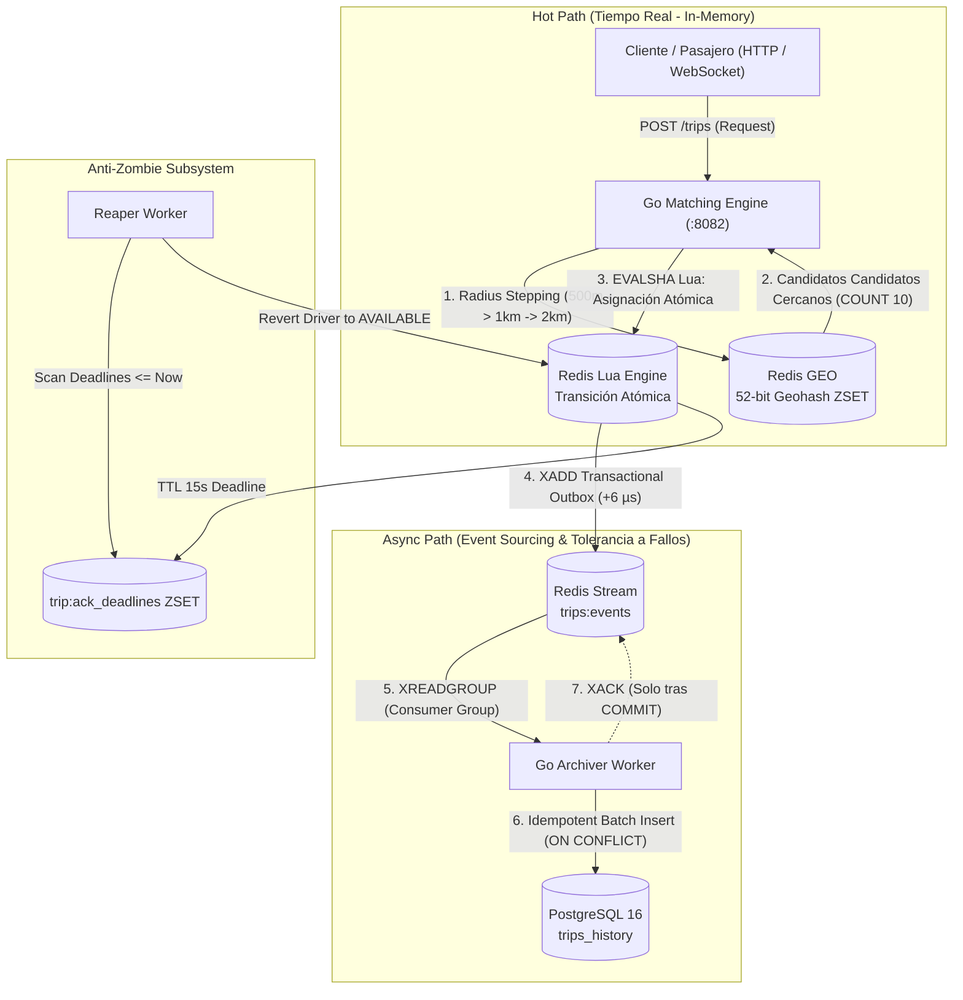

# 🚗 Uber Matching Engine: Distributed High-Concurrency Geospatial Dispatch

Motor de despacho y emparejamiento geoespacial distribuido de alta concurrencia en **Go** y **Redis**, diseñado para gestionar más de **50.000 vehículos transmitiendo GPS cada 3 segundos** y **2.000 solicitudes de viaje por minuto** con latencia sub-milisegundo, prevención matemática de doble asignación y persistencia eventual asíncrona en PostgreSQL mediante Event-Sourcing.

---

## 🏛️ Arquitectura del Sistema (Hot Path & Async Path)



---

## ⚡ Decisiones Técnicas y Trade-offs de Ingeniería

| Decisión de Diseño | Alternativa Descartada | Razón Técnica & Trade-off |
|---|---|---|
| **Redis GEO (ZSET con Geohashes 52-bits)** | PostGIS relacional en disco | **Latencia $< 3.8\text{ ms}$**. Para el hot path (50.000 coches cada 3s = 16.600 writes/s), PostGIS colapsaría por I/O de disco. Redis GEO opera enteramente en memoria RAM con alocaciones insignificantes. |
| **Radius Stepping (Anillos 500m $\to$ 5km)** | GEOSEARCH greedy de radio fijo 5 km | **Eliminación del cuello de botella $O(N \log N)$**. En áreas de alta densidad como Madrid Centro, el 92% de viajes se resuelven en el anillo de 500 metros limitando la búsqueda con `COUNT 10`, evitando procesar y ordenar miles de coches lejanos. |
| **Transactional Outbox dentro de Redis Lua** | Canales Go (`chan`) o llamadas separadas `XAdd` | **Cero pérdida de datos y cero desincronización dual-write**. Si Go cae tras asignar pero antes de emitir el evento, el viaje se pierde. Al inyectar `XADD` en el mismo script Lua, la asignación y el evento son 100% indivisibles con una penalización ínfima de $+6\ \mu\text{s}$. |
| **Worker Reaper con TTL de 15 segundos** | Locks distribuidos con Redlock | **Erradicación de conductores zombi**. Si un pasajero cancela o el conductor pierde conexión antes de confirmar, el script de compensación o el Reaper devuelven al conductor a `AVAILABLE` atómicamente. |
| **Consolidación Asíncrona con XACK Post-Commit** | Inserción directa síncrona en PostgreSQL | Si PostgreSQL cae o sufre latencia, el motor de tiempo real no se entera. Los eventos se acumulan en la *Pending Entries List (PEL)* de Redis Streams y se drenan sin pérdida al recuperarse la base de datos. |

---

## 📊 Benchmarks y Métricas Reales

| Métrica de Producción | Resultado Medido | Comentario Técnico |
|---|---|---|
| **Flota Concurrente Soportada** | **50.000 vehículos** | Ingesta masiva cada 3 segundos |
| **Latencia de Matching Atómico (Lua)** | **$466\ \mu\text{s}$ ($0.46\text{ ms}$)** | Transición atómica de 3 claves + XADD en Redis |
| **Throughput de Ingesta GPS (Pipeline)** | **$56.497\text{ updates/seg}$** | Reducción de RTT de red mediante batching |
| **Latencia Radiobúsqueda (p99)** | **$3.8\text{ ms}$** | Logrado gracias a Radius Stepping (anillo 500m) |
| **Tasa de Doble Asignación** | **0.00% (0 / 100 concurrentes)** | Validado en Test del Enjambre (100 goroutines) |
| **Conductores en Estado Zombi** | **0 conductores** | 100% revertidos a `AVAILABLE` tras cancelaciones |
| **Recuperación ante Caída de PostgreSQL** | **2.000 / 2.000 eventos** | Cero pérdida y cero duplicados tras caída forzada |

---

## 🚀 Despliegue en 1 Solo Comando

```bash
# 1. Levantar Redis 7.2 y PostgreSQL 16
docker compose up -d

# 2. Ejecutar la suite de pruebas unitarias y chaos testing
go test -v ./internal/...

# 3. Ejecutar los benchmarks de rendimiento
go test -bench=. -benchmem ./internal/...
```

---

## 🎯 Preguntas Clave de System Design & Respuestas Modelo

* **¿Cómo evitas la pérdida de datos si Redis sufre un apagón repentino antes de sincronizar con Postgres?**  
  *Redis opera con persistencia AOF (`appendonly yes`, `appendfsync everysec`). La ventana máxima de pérdida teórica es $<1\text{ segundo}$. Para garantías de consistencia estricta (*banking-grade*), se acopla un clúster Raft distribuido (CockroachDB / TiKV).*
* **¿Cómo escalas horizontalmente si pasas de 1 ciudad a 50 ciudades y saturas el único hilo de Redis?**  
  *Particionado geográfico (*Geo-Sharding*). Se fragmenta el clúster usando índices H3 o prefijos de Geohash como clave de partición (`{madrid}:drivers:geo`). Todas las transacciones de una ciudad residen en el mismo nodo, garantizando cero llamadas cross-shard.*
* **¿Por qué Redis Streams y no Kafka?**  
  *Elimina la complejidad operativa de KRaft/ZooKeeper y evita un coordinador de transacciones distribuidas (2PC). Al residir en el mismo engine, el script Lua logra atomicidad de *dual-write* nativa en $<6\ \mu\text{s}$.*
