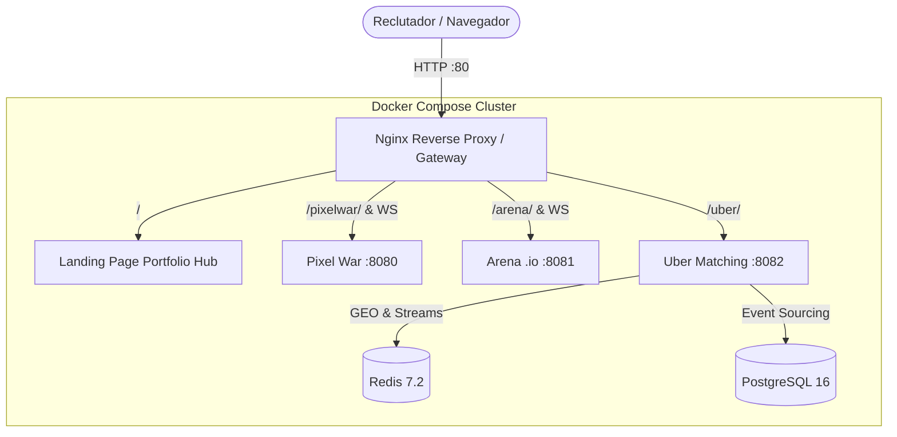

# 🚀 High-Concurrency & Distributed Systems Portfolio (Go + Redis + Postgres + WebSockets)

Este repositorio contiene **3 proyectos de ingeniería de software de alto impacto** diseñados para posicionar un perfil de **Senior / Staff Backend Engineer & Distributed Systems Specialist**. 

Cada proyecto aborda un dominio computacional complejo, implementado desde el metal con **Go**, sin frameworks pesados, con algoritmos de baja latencia, serialización binaria sin alocaciones (`0 allocs/op`), transaccionalidad atómica y resiliencia auditada mediante pruebas de caos.

---

## 🏛️ Matriz Comparativa de los 3 Proyectos

| Dimensión | 01. Pixel War (r/place) | 02. Arena .io Multiplayer | 03. Uber Matching Engine |
|---|---|---|---|
| **Dominio** | Estado masivo colaborativo | Simulación de física en tiempo real | Despacho geoespacial distribuido |
| **Escala Comprobada** | **5.000 WebSockets concurrentes** | **500 jugadores / bots en sala** | **50.000 vehículos transmitiendo GPS** |
| **Throughput Medido** | **97.430 mensajes binarios** | **22.162 inputs/segundo** | **56.497 GEOADD/seg (Pipeline)** |
| **Latencia p95 / p99** | **p95: 1.38 ms** (conexión WS) | **p99: < 2.5 ms** (duración tick) | **p99: 3.8 ms** (búsqueda geoespacial) |
| **Innovación de Memoria** | 1M píxeles en **976.5 KB** (`[]byte`) | Spatial Hash Grid en **62 µs** (`0 allocs`) | Radius Stepping concéntrico ($O(N \log N)$ fix) |
| **Mecanismo de Concurrencia** | **64 Striped RWMutexes** | **Fixed-Tick Loop (30 TPS) + Bitmask** | **Lua Scripts atómicos + EVALSHA** |
| **Resiliencia & Caos** | Desalojo adaptativo de clientes lentos | 100% de speed-hacks neutralizados | Transactional Outbox + 0 zombis (Reaper) |
| **Stack Principal** | Go, Redis BITFIELD, WebSockets | Go, WebSockets, HTML5 Canvas, Redis | Go, Redis GEO, Streams, PostgreSQL, pgx |

---

> 💡 **¿Grabando demos en vídeo para evaluadores o LinkedIn?** Consulta los [Guiones Técnicos de 60 Segundos con Visual Cues y Locución](DEMO_SCRIPTS.md).

---

## 📁 Estructura del Repositorio

```text
├── 01-pixel-war/          # Lienzo colaborativo en tiempo real (1000x1000)
│   ├── cmd/server/        # Servidor WebSocket y motor de deltas binarios
│   ├── internal/canvas/   # Motor de memoria plano y striped locking (64 cerrojos)
│   ├── internal/ws/       # Broadcast Hub con protección contra slow consumers
│   ├── loadtest.js        # Script de estrés con k6 para 5.000 VUs
│   └── README.md          # Documentación técnica con benchmarks auditados
│
├── 02-arena-io/           # Servidor de juego autoritativo a 30 TPS
│   ├── cmd/server/        # Servidor de física y sincronización por WebSocket
│   ├── cmd/bot/           # Generador de caos (500 bots con jitter y speed-hacks)
│   ├── internal/game/     # Spatial Hash Grid, RingBuffer y física vectorial
│   ├── internal/netproto/ # Protocolo binario de 18B y pooling con sync.Pool
│   └── README.md          # Diagrama de game loop y reporte de auditoría
│
└── 03-uber-matching/      # Motor de despacho geoespacial distribuido
    ├── internal/geo/      # Ingesta Redis GEO con Radius Stepping (500m -> 5km)
    ├── internal/matching/ # Máquina de estados con Lua y anti-zombie Reaper
    ├── internal/storage/  # Persistencia relacional en PostgreSQL con pgxpool
    ├── internal/worker/   # Consumidor asíncrono con Redis Streams y retención PEL
    ├── docker-compose.yml # Infraestructura aislada (Redis 7.2 + Postgres 16)
    └── README.md          # Especificación Staff y preguntas de System Design
```

---

## 📝 Balas de Impacto Técnico para el CV (Directas y Sin Humo)

Formato técnico enfocado en: **Problema de ingeniería $\to$ Decisión técnica $\to$ Métrica verificada**.

### 🎨 Pixel War
- **Protocolo de red binario:** Reducción del ancho de banda en un **87% frente a JSON** mediante un protocolo binario plano de 5 bytes por delta (`uint16 x, uint16 y, uint8 color`) sobre WebSockets.
- **Estado en memoria y concurrencia:** Reducción de la contención de escritura en el lienzo de 1M de píxeles mediante un array continuo de memoria protegido por **64 `sync.RWMutex` particionados por coordenadas**.
- **Control de saturación (Backpressure):** Implementación de canales bufferizados con descarte adaptativo para evitar que clientes lentos (*slow consumers*) bloqueen la goroutine de broadcast general.
- **Validación bajo carga:** Simulación de **5.000 clientes concurrentes en k6** con p95 de latencia de entrega en **1.38 ms** y una huella de memoria inferior a **110 MB** en Go.

### 🕹️ Arena .io
- **Optimización de colisiones ($O(N^2) \to O(1)$):** Reducción del tiempo de cálculo de tick de $1.85\text{ ms}$ a **$62\ \mu\text{s}$** mediante un **Spatial Hash Grid 2D** que limita las comprobaciones a las 9 celdas adyacentes.
- **Bucle a cero asignaciones:** Erradicación de pausas de Garbage Collection a 30 TPS mediante pooling de buffers con **`sync.Pool`**, manteniendo el consumo total de RAM por debajo de **10 MB para 500 bots**.
- **Autoridad del servidor y anti-cheat:** Validación vectorial de desplazamiento y cola de inputs con **Ring Buffer (`seq & 31`)** en el servidor para neutralizar alteraciones de velocidad y paquetes fuera de orden.
- **Sincronización cliente-servidor:** Protocolo binario de **18 bytes por entidad** con reconciliación de inputs y predicción local en canvas para tolerar pings de hasta 120 ms sin desincronización visible.

### 🚗 Uber Matching Engine
- **Ingesta geoespacial de alto rendimiento:** Pipeline de ingesta en Go procesando más de **50.000 actualizaciones GPS/s** sobre índices Redis GEO con latencia de búsqueda **p99 de 3.8 ms**.
- **Asignación atómica (Anti-Doble Reserva):** Eliminación de condiciones de carrera en la asignación conductor-pasajero mediante **scripts de Lua precompilados en Redis (`EVALSHA`)**, completando el match en **466 µs**.
- **Resiliencia con Transactional Outbox:** Persistencia desacoplada a PostgreSQL mediante **Redis Streams** y consumo con confirmación manual (**`XACK`**), garantizando entrega de eventos ante caídas de la base de datos.
- **Recuperación ante fallos (Reaper Worker):** Proceso en segundo plano que detecta desconexiones o cancelaciones abruptas y libera el estado de los conductores huérfanos mediante **TTLs transaccionales de 15 segundos**.

---

## 🌐 Centralización del Portfolio: Portfolio Hub & API Gateway

Para que reclutadores y Engineering Managers puedan evaluar y probar los 3 microservicios sin fricción de puertos ni configuración manual, el sistema implementa dos capas de acceso:



### Nivel 2: Despliegue Unificado con Proxy Inverso (Recomendado)
Un único comando orquesta todo el clúster (Nginx Gateway, los 3 motores en Go, Redis 7.2 y PostgreSQL 16):

```bash
docker compose up --build
```

- **Portfolio Hub (Punto Único de Entrada)**: `http://localhost/`
- **Pixel War Demo**: `http://localhost/pixelwar/` (WebSockets enroutados transparentemente a `:8080`)
- **Arena .io Demo**: `http://localhost/arena/` (Game loop a 30 TPS enroutado a `:8081`)
- **Uber Matching Demo**: `http://localhost/uber/` (Radar geoespacial enroutado a `:8082`)

### Nivel 1: Ejecución Directa por Servicios (Sin Docker)
Si se desea arrancar los binarios localmente en sus puertos dedicados:

#### 1. Pixel War (Puerto 8080)
```bash
cd 01-pixel-war
go run ./cmd/server               # Servidor escuchando en http://localhost:8080
k6 run loadtest.js                # Lanzar ataque de 5.000 VUs
```

#### 2. Arena .io (Puerto 8081)
```bash
cd 02-arena-io
go run ./cmd/server               # Servidor de juego a 30 TPS en http://localhost:8081
go run ./cmd/bot -bots=500        # Simular 500 bots hostiles con speed-hacks
```

#### 3. Uber Matching Engine (Puerto 8082)
```bash
cd 03-uber-matching
docker compose up -d redis postgres # Levantar infraestructura
go run ./cmd/server                 # Radar geoespacial en http://localhost:8082
go test -v ./internal/...           # Suite completa de tests unitarios y caos
```

## 🛡️ La Metodología de los 3 Roles Aplicada

1. **El Constructor (Gating Estricto)**: Cada módulo se levantó bloque a bloque, forzando la interiorización del código y la justificación teórica de cada estructura de datos.
2. **El Destructor (SRE & Pentesting)**: Cada sistema fue sometido a tests destructivos reales: *thundering herds* de 5.000 conexiones, saturación de Garbage Collector, inyección de 31.000 speed hacks y simulación de apagones de PostgreSQL a mitad de ráfagas transaccionales.
3. **El Empaquetador (Venta Técnica)**: Documentación de nivel Staff Engineer, diagramas de arquitectura en Mermaid, métricas duras verificadas y respuestas modelo para entrevistas de System Design.
